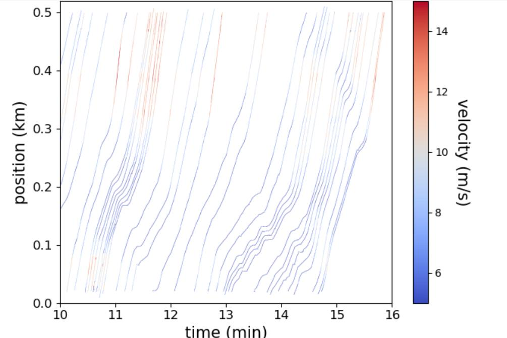
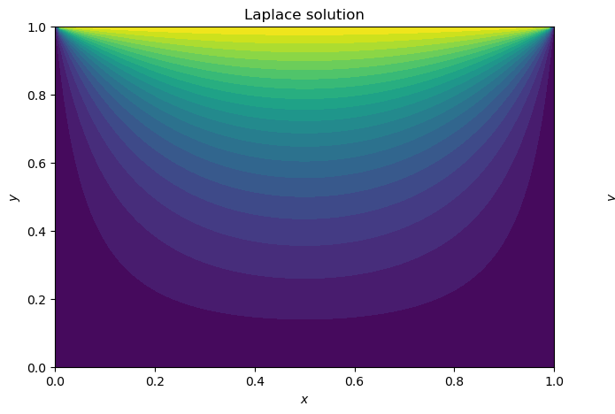

# Engineering Projects – Eoin McMahon

Code from my Mechanical Engineering studies at **University College Dublin** and the **National University of Singapore**. Each folder is a self-contained project with its own README explaining the problem, the method and the results.

| Project | Language | What it does |
|---|---|---|
| [Autonomous Robot](autonomous-robot/) | C++ (Arduino) | Heading control with an IMU, wheel odometry and distance sensing for a competition robot built by a team of three (UCD) |
| [Traffic Shockwaves](traffic-shockwaves/) | Python | Analyses real vehicle trajectory data (NGSIM) to reveal stop-and-go shockwaves travelling back through traffic |
| [Heat Plate Discretisation](heat-plate-discretisation/) | Python | Solves the 2D heat equation with an implicit finite difference scheme and Gauss-Seidel iteration, validated against the Laplace solution (NUS) |

<p align="center">
  
  
</p>

## Skills shown
- **Embedded C++**: sensor reading (IMU, optical encoder, IR distance), motor PWM control, proportional feedback control, interrupts
- **Python for engineering**: NumPy, pandas and Matplotlib for data processing and visualisation
- **Numerical methods**: finite differences, implicit time stepping, iterative solvers and convergence criteria

## Running the Python projects
```bash
pip install -r requirements.txt
```
Then run the scripts inside each project folder.

## Contact
- LinkedIn: [eoin-mcmahon](https://www.linkedin.com/in/eoin-mcmahon-760006344/)
- Email: eoinmcmahon04@outlook.com
