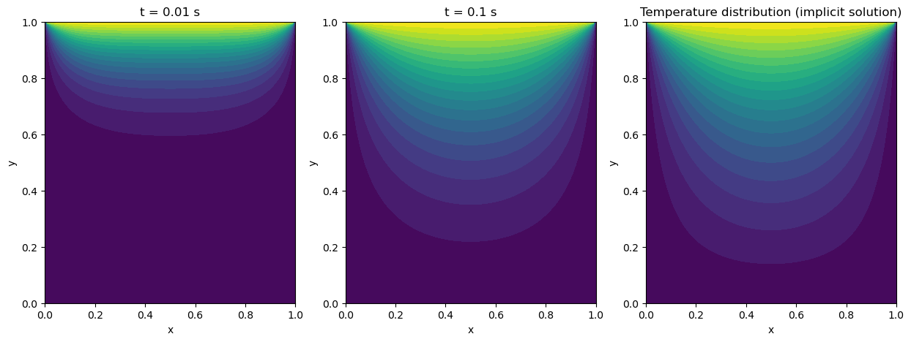
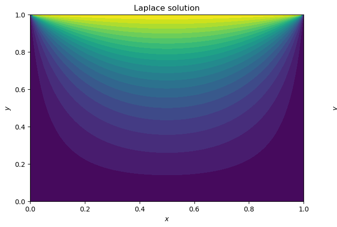
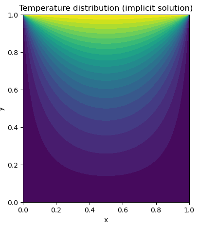

# Heat Plate Discretisation – 2D Heat Equation (ME3291, NUS)

This project models how heat spreads through a square plate when one edge is suddenly heated. It solves the problem numerically in two ways and checks that they agree.

## Problem
A 1 × 1 plate starts at temperature 0. At t = 0 the **top edge is held at T = 1**, while the other three edges stay at T = 0 (Dirichlet boundary conditions). Temperature evolves according to the 2D heat equation:

$$\frac{\partial T}{\partial t} = \frac{\partial^2 T}{\partial x^2} + \frac{\partial^2 T}{\partial y^2}$$

## Method

### 1. Transient solution: implicit finite differences ([`heat_equation_implicit.py`](heat_equation_implicit.py))
- The plate is divided into a **100 × 100 grid**. Second derivatives use the 5-point, second-order central difference stencil.
- Time is stepped **implicitly** with Δt = 0.01. An implicit scheme stays stable for large time steps, unlike an explicit one.
- Each time step is solved with **Gauss-Seidel iteration**, which uses newly updated neighbour values as soon as they are available:

$$p_{i,j}^{k+1} = \frac{p_{i,j}^{k} + \alpha\left(p_{i-1,j}^{k+1} + p_{i+1,j}^{k+1} + p_{i,j-1}^{k+1} + p_{i,j+1}^{k+1}\right)}{1 + 4\alpha}, \qquad \alpha = \frac{\Delta t}{\Delta x^2}$$

- Convergence is measured with the **L2 norm** of the change between iterations. The tolerance is 1 × 10⁻⁶ and the cap is 5,000 iterations.

### 2. Steady-state solution: Laplace equation ([`laplace_steady_state.py`](laplace_steady_state.py))
Removing time gives the Laplace equation. Each interior node then becomes the average of its four neighbours, solved with Gauss-Seidel iteration to a tolerance of 1 × 10⁻¹⁰:

$$p_{i,j} = \tfrac{1}{4}\left(p_{i-1,j} + p_{i+1,j} + p_{i,j-1} + p_{i,j+1}\right)$$

## Results

**Transient solution at t = 0.01 s, t = 0.1 s and steady state.** Heat starts as a thin, steep layer near the heated edge and spreads smoothly downwards until the field stops changing.



**Validation.** The Laplace solution (left) is almost identical to the steady state reached by the transient simulation (right). This confirms that the time-dependent solver converges to the correct long-term answer.

<p align="center">
  
  
</p>

## Running
```bash
pip install numpy matplotlib tqdm
python heat_equation_implicit.py
python laplace_steady_state.py
```
The solvers use plain Python loops to keep the method easy to follow, so the full 100 × 100 run takes several minutes. For a quick test, reduce `nx, ny`.
