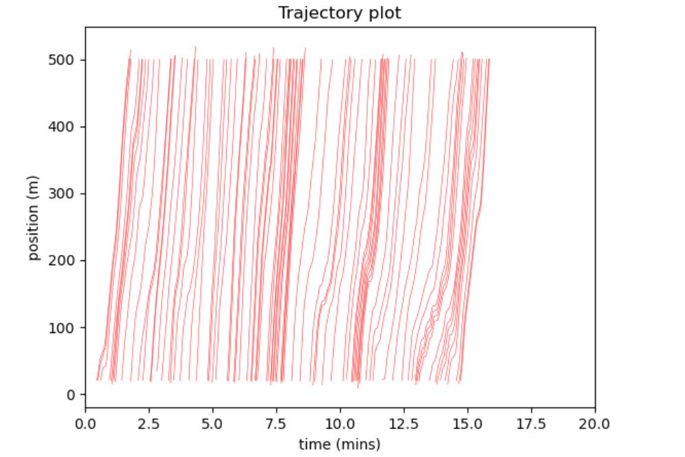
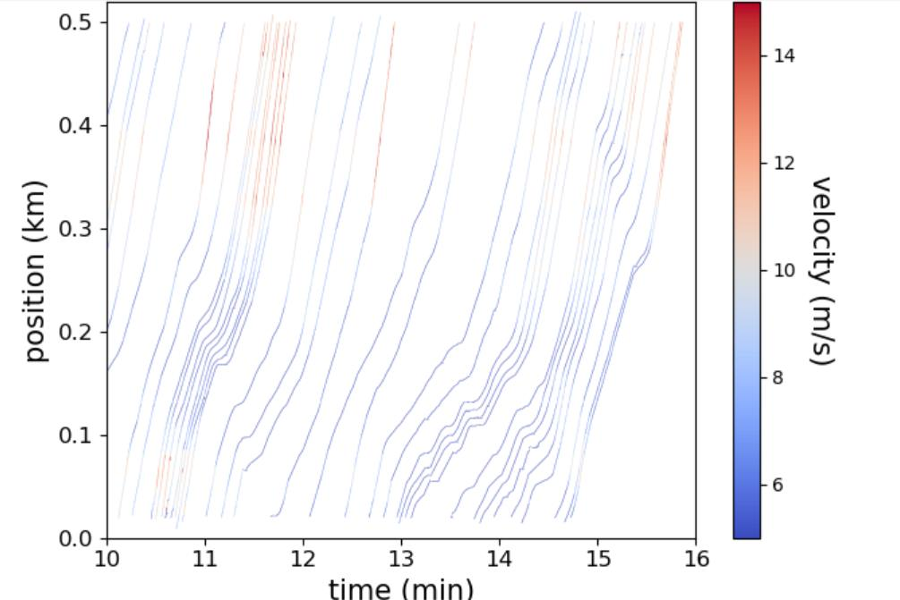

# Traffic Shockwaves from Real Vehicle Data

Stop-and-go traffic jams often have no obvious cause. One driver brakes, the car behind brakes harder, and a wave of slow traffic travels **backwards** along the road even as every car keeps moving forwards. This project uses real vehicle trajectory data to make those waves visible.

## Data
The data is the **NGSIM** (Next Generation Simulation) dataset from the U.S. Department of Transportation. It records the position of every vehicle on a stretch of highway every 0.1 s. The script uses five columns:

| Column | Meaning | Units in the file |
|---|---|---|
| `Vehicle_ID` | Vehicle identifier | – |
| `Local_X` | Position across the road | ft |
| `Local_Y` | Position along the road | ft |
| `Global_Time` | Timestamp | ms |
| `v_Vel` | Speed | ft/s |

The dataset is too large to store here. Download it from the [U.S. DOT data portal](https://data.transportation.gov/Automobiles/Next-Generation-Simulation-NGSIM-Vehicle-Trajector/8ect-6jqj), save it as `NGSIM.csv` in this folder, and run:

```bash
python traffic_waves.py
```

## Method
1. **Convert units**: feet to metres, milliseconds to minutes.
2. **Pick a lane**: each vehicle is assigned to one of seven lanes using its average lateral position. Lane 6 showed the clearest patterns.
3. **Sanity checks**: vehicles with empty records or impossible backward jumps are flagged.
4. **Plot trajectories**: position against time for every vehicle in the lane. The slope of each line is that vehicle's speed.
5. **Colour by speed**: each trajectory is split into short segments with Matplotlib's `LineCollection`, and each segment is coloured by its instantaneous speed.

## Results

**All trajectories in the lane.** The kinks where lines bend and flatten are vehicles slowing down.



**Zoomed to 10–16 min and coloured by speed.** The slow (dark blue) bands clearly run diagonally *down and to the right*, meaning the congestion moves back up the road against the direction of travel. That backward-moving band is the shockwave.



## Notes
This was university coursework, built on a notebook template provided by the module. My work covered choosing the lane, tuning the plots and time window to expose the shockwaves, and interpreting the results. I have since tidied the code into a single script.
